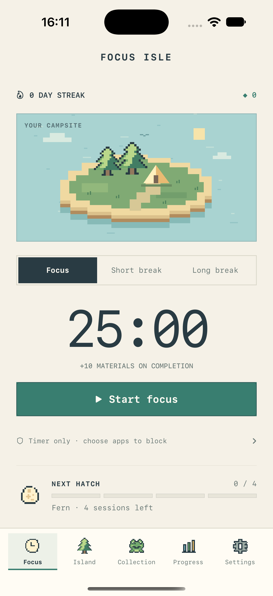

# focussi — Beta 1.0

A native iPhone focus timer that turns completed sessions into a pixel-art island. Built with SwiftUI for **iOS 17+**, with on-device saves and no accounts or third-party package dependencies.

[Install on iPhone](docs/INSTALL_IPHONE.md) · [Beta 1.0 release notes](docs/releases/beta-1.0.md) · [Changelog](CHANGELOG.md)

## Choose a build

| Scheme | Signing | App blocking |
| --- | --- | --- |
| **focussi Personal** | Free Apple Personal Team | Not included |
| **FocusIsle** | Apple Developer Program team and Screen Time capabilities | Family Controls, Managed Settings, and a Device Activity Monitor extension |

Both builds include the timer, island, collection, streaks, progress history, and local notifications. Personal provisioning expires after seven days; rebuild and reinstall with the same bundle identifier to renew it. The full build requires additional setup and physical-device verification; see [Screen Time setup](docs/SCREEN_TIME.md).

**Release tag:** `v1.0.0-beta.1`. This is a source-only beta: build and sign it with your own Xcode setup. No signed IPA is supplied.

## Run

Open `FocusIsle.xcodeproj` in Xcode 16 or newer. Choose a scheme and simulator, then press **⌘R**. The local `FocusCore` package resolves from the repository. For a physical phone, follow the [installation guide](docs/INSTALL_IPHONE.md) to configure your own signing settings.

```sh
xcodebuild -project FocusIsle.xcodeproj -scheme 'focussi Personal' -configuration Debug -destination 'generic/platform=iOS Simulator' build
```

For the full simulator build, use `-scheme FocusIsle`. Simulator builds do not validate app blocking.

## What is included

- Manual focus and break timers; saved deadlines survive locking and relaunch.
- Early-end confirmation, session-end notifications, and editable session lengths.
- A pixel-art island with six permanent decorations, six creatures, and streak keepsakes.
- Current and longest streaks, completed sessions, total focus minutes, calendar, and recent history.
- Local JSON storage, including saved materials and collection progress.

Focus defaults to **25 minutes**, with **5-minute short breaks** and **15-minute long breaks**. A long break is suggested after four completed focus sessions. Every completed focus session earns **10 materials**; every fourth hatches a creature, with progress carried across days. The hatch cycle repeats after all six discoveries.

One completed focus session qualifies a local day. Streak milestones at **3, 7, 14, and 30 days** unlock permanent keepsakes. Ending early earns no reward or streak credit. A missed day resets the current streak without removing earned items.



[Compact layout](docs/screenshots/focus-compact-pixel.png) · [Island](docs/screenshots/island-pixel.png) · [Collection](docs/screenshots/collection-pixel.png)

## Try the island instantly

In a **Debug** build, open **Settings → Island testing → Enter test island**. Add 100 materials, simulate one or four focus sessions, and open Island to place decorations. Use **Exit test** to return to the main island.

Test progress has its own save. It never changes main-island progress, blocks apps, or schedules alerts. Switch islands only while no timer is active. Testing controls and hooks are excluded from Release builds.

## Verification

```sh
swift run FocusCoreChecks
swift run -c release FocusCoreChecks
```

**13 checks pass in Debug; 12 pass in Release.** They cover deadline recovery, duplicate rewards, early endings, hatching, breaks, midnight and missed-day streaks, milestones, purchases, persistence, duration limits, calendar preferences, and daylight saving time. The additional Debug check validates test-island reward controls and their active-timer guard. The checks run without Swift Testing or external packages.

Beta limits: island placement is fixed, storage is local only, and full Screen Time blocking remains unverified on a physical device. See the [release notes](docs/releases/beta-1.0.md) for timing, timezone, and signing limits.

## Project and artwork

- `FocusIsle/`: SwiftUI app, pixel-art sprites, theme, and services.
- `Sources/FocusCore/` and `Tests/FocusCoreTests/`: timer, rewards, persistence, and regression checks.
- `FocusIsleMonitor/` and `Shared/`: full-build background blocking support.

The app is named **focussi**; the existing Xcode project and full scheme retain the **FocusIsle** name. In-app pixel artwork is drawn locally with SwiftUI Canvas. [App icon source](docs/branding/focussi-icon-source.png) · [ImageGen artwork prompt](docs/branding/focussi-icon-prompt.md).
